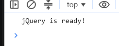
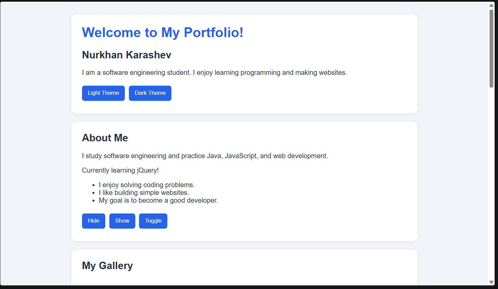
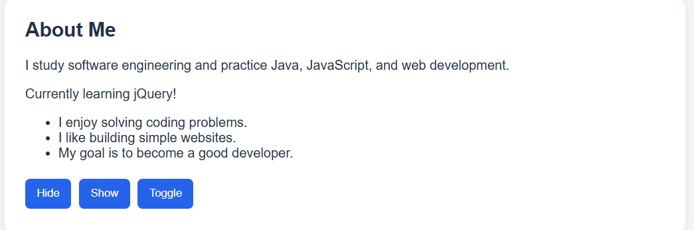
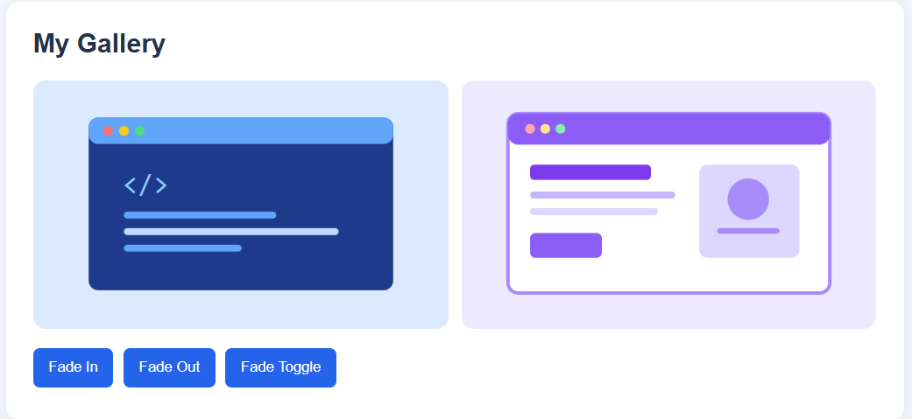
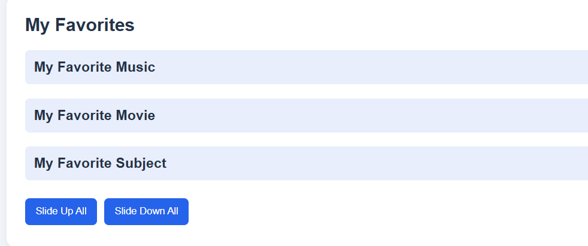
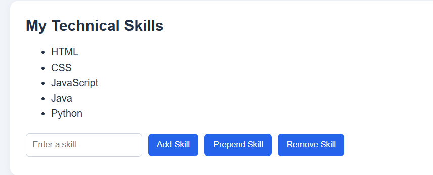
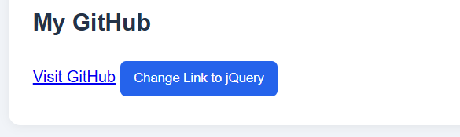
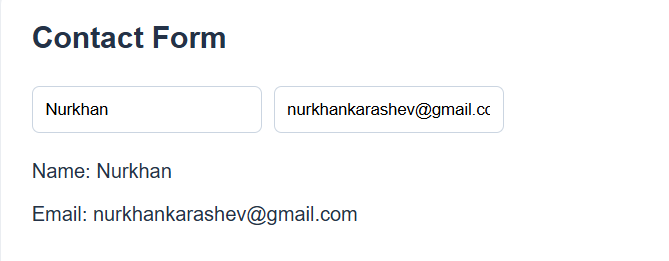
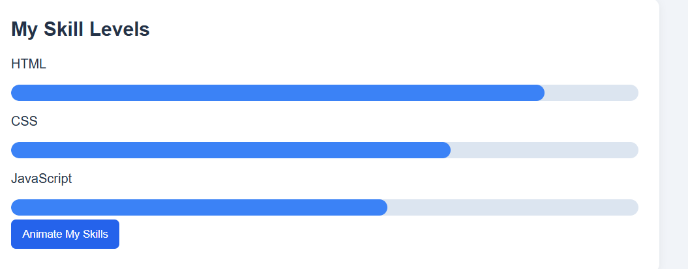

# Assignment 6 

Name: Nurkhan Karashev  
Group: SE-2540

## Task 0 - Setup
I connected jQuery using a CDN and used `$(document).ready()`. The console shows `jQuery is ready!`.

## Task 1 - Selectors and CSS
I made a portfolio page with my name and introduction. I used tag, ID and class selectors, changed text and CSS, and added light and dark themes.

## Task 2 - Visibility
I added an About Me section. The Hide, Show and Toggle buttons control the status message.

## Task 3 - Fade
I added two pictures and three buttons to fade the pictures in and out.

## Task 4 - Slide
I added three clickable headings. Clicking a heading opens or closes the information with a slide effect. There are also buttons to open and close all panels.

## Task 5 - Add and Remove Skills
I made a list with four skills. I can add a skill at the end or beginning and remove the last one. Empty input is not added.

## Task 6 - Attributes
I added a GitHub link. The button changes the link to the jQuery website using `.attr()`.

## Task 7 - Form
I made name and email fields. The typed information appears below the form immediately.

## Task 8 - Animation
I made three skill bars. The button animates their width, and pressing it again resets them to zero.

## Work Summary
I created the HTML structure, styled it with CSS and used jQuery for buttons, effects, form updates and animations. I tested the buttons and checked the page in a browser.

## How to Run
Open `index.html` in a browser with an internet connection for the jQuery CDN.
